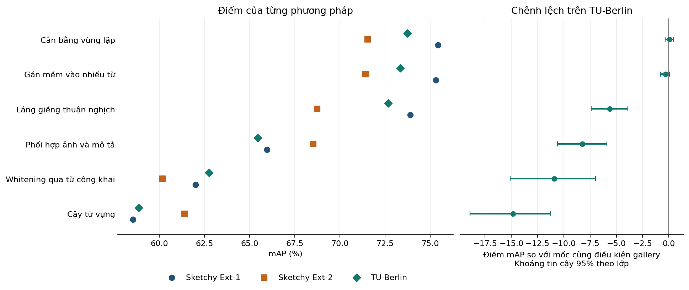

# Sáu cơ chế training-free từ image retrieval cho ZS-SBIR

**Hướng mới đứng đầu theo trung bình mAP của hai split Sketchy là gộp các vùng của từng ảnh.** Nó đạt **75,43 / 71,54 / 73,74 mAP** trên Sketchy Ext-1, Ext-2 và TU-Berlin. Đối chứng gộp đều cho kết quả gần như y hệt. Trong các cách chấm từng cặp đã đo, phương pháp dịch qua từ công khai từ đợt trước vẫn đứng đầu theo tiêu chí Sketchy với **75,96 / 71,60 / 73,68**. Khi có thể dùng toàn gallery không nhãn để lập chỉ mục, mốc prior và lân cận ảnh đạt **82,65 / 74,79 / 78,32**. [Khóa năm nhánh](results/image-retrieval-round/joint-freeze.json) · [Khóa bổ sung của gán mềm](results/image-retrieval-round/extra-joint.json) · [Khóa của bước dò hẹp](results/image-retrieval-round/bandwidth-decision.json)

Tôi đọc và đối chiếu 20 công trình về truy hồi đối tượng, truy hồi người xuyên camera, truy hồi ảnh–văn bản và composed image retrieval. Mỗi nhánh dưới đây kiểm tra một cơ chế với đối chứng cụ thể. Tất cả dùng cùng checkpoint OpenAI CLIP ViT-B/32 đóng băng trên Colab L4. Năm hướng mới có điểm cho mỗi cặp độc lập với những ảnh khác. Nhánh láng giềng thuận nghịch cần một chỉ mục của gallery. Các phương pháp dùng từ lấy cùng 20.931 mục từ công khai của Open Images. [Nghiên cứu gốc, hiện tượng và thiết kế từng phép thử](IMAGE_RETRIEVAL_READING_VI.md)

## Kết quả trên toàn bộ truy vấn

Mỗi ô ghi **mAP / precision (%)**. Ext-1 dùng mAP@all / P@100 cho 14.179 sketch và 17.100 photo. Ext-2 dùng mAP@200 / P@200 cho 12.694 sketch và 12.552 photo. TU dùng mAP@all / P@100 cho 2.130 sketch và 27.262 photo thuộc 30 lớp.

| Phương pháp | Ext-1 | Ext-2 | TU-Berlin |
|---|---:|---:|---:|
| Cosine trực tiếp của CLIP gốc | 30,29 / 41,64 | 36,34 / 33,85 | 29,07 / 46,26 |
| Dịch qua bảy từ gần nghĩa, mốc từng cặp trước đợt này | **75,96 / 78,87** | **71,60 / 70,66** | **73,68 / 77,00** |
| Democratic aggregation trên các vùng | 75,43 / 79,05 | 71,54 / 70,37 | 73,74 / 77,60 |
| Gán mềm, bước chọn đầu tiên lấy lại hai nhiệt độ gốc | 75,31 / 78,94 | 71,42 / 70,28 | 73,35 / 77,22 |
| Cùng nhánh gán mềm sau khi dò hẹp nhiệt độ | 75,21 / 79,29 | 71,74 / 70,48 | 73,10 / 77,35 |
| Mã hóa láng giềng thuận nghịch, dùng gallery | 73,90 / 76,03 | 68,74 / 68,19 | 72,68 / 75,80 |
| Phối hợp ảnh và mô tả theo WeiMoCIR | 65,97 / 77,24 | 68,52 / 65,36 | 65,45 / 75,52 |
| Whitening mô tả ảnh theo hệ trục từ công khai | 62,01 / 68,30 | 60,18 / 58,34 | 62,77 / 69,10 |
| Cây từ vựng phân cấp | 58,55 / 68,76 | 61,40 / 57,92 | 58,85 / 70,25 |
| Prior ước lượng và lân cận RGB, mốc gallery trước đợt này | 82,65 / 82,10 | 74,79 / 73,59 | 78,32 / 77,60 |

Sáu pilot gồm 183 cấu hình. Một lượt dò hẹp thêm 36 cấu hình cho cùng cơ chế gán mềm. Mỗi pilot dùng 48 sketch/lớp và tất cả ảnh. Sau đó chấm toàn bộ query cho các ứng viên dẫn đầu, cấu hình tham chiếu và ablation đã định trước. Cấu hình dùng chung cho hai Sketchy được chọn theo trung bình mAP với trọng số bằng nhau, dùng precision khi hòa. Chỉ các cấu hình trong tập ứng viên định trước tham gia chọn. Vì thế một ablation có thể vượt cấu hình được chọn. Kết quả trên hai split unseen của Sketchy là thăm dò. Mọi điểm TU trong bảng đều được chấm theo quyết định đã khóa tương ứng. [Toàn bộ mAP, precision theo cấu hình](results/image-retrieval-round/metrics.csv) · [Toàn bộ kết quả theo lớp](results/image-retrieval-round/classes.csv) · [Chi tiết bước dò hẹp](results/image-retrieval-round/bandwidth-summary.json)

Hình dùng cấu hình chọn ở lượt đầu của sáu nhánh. Mốc TU để tính chênh lệch theo từng query là phương pháp dịch từ cho năm nhánh chấm từng cặp, và prior cùng lân cận RGB cho nhánh cần toàn gallery.

## Mỗi thí nghiệm cho biết điều gì

**1. Gộp vùng của từng ảnh.** Bài *Democratic Aggregation* giảm ảnh hưởng của các descriptor lặp. Ở SBIR, giữ vị trí gốc của patch và lấy CLS của cửa sổ bằng thủ tục WinCLIP, sau đó gộp các vùng cùng ảnh trước khi chấm qua từ vựng. Sketchy chọn chín cửa sổ 5×5 trên lưới 7×7 của photo, gộp thành một vector rồi kết hợp với toàn khung. Trên TU, toàn bộ bước thêm vùng tăng **0,39 điểm mAP**, khoảng 95% theo lớp **[0,09, 0,68]**, có 24/30 lớp tăng. Thay riêng trọng số democratic bằng trọng số đều chỉ đổi **0,0003 điểm**. Khi nhân thêm ba bản sao của một cửa sổ, độ dịch cosine trung bình của descriptor photo TU là 0,00194 với gộp đều và 0,00183 với democratic. Phần xử lý lặp thực sự có tác dụng trên descriptor, nhưng hiệu ứng ở bảng xếp hạng rất nhỏ. [Phương pháp, nguồn và branch](https://github.com/HieuNM1804/training-free-ZS-SBIR/blob/research/retrieval-democratic-regions/docs/RETRIEVAL_DEMOCRATIC_REGIONS_VI.md)

**2. Gán mềm vào visual words.** Với ảnh được mô tả qua các embedding từ, hệ số Gaussian điều khiển số khái niệm còn có trọng số đáng kể. Cấu hình tham chiếu ba từ, cùng độ rộng và cosine chỉ cho **33,74 / 62,43 / 32,39**. Khi dùng tất cả từ, so tích của hai phân bố chuẩn hóa theo tổng, lượt chọn đầu quay về nhiệt độ checkpoint. Dò hẹp chọn hệ số nghịch đảo nhiệt độ của sketch bằng 0,875 lần checkpoint và hệ số photo bằng 1. So với checkpoint, mAP đổi **−0,10 / +0,33 / −0,25 điểm**. Ở Ext-2 khoảng 95% là [0,19, 0,46], ở TU là [−0,42, −0,08]. Điều chỉnh nhiệt độ chỉ dựa vào kết quả tốt ở một split dễ dẫn đến kết luận thiếu tính chuyển giao. [Philbin và cộng sự, CVPR 2008](https://www.robots.ox.ac.uk/~vgg/publications/2008/Philbin08/philbin08.pdf) · [Nhánh gán mềm](https://github.com/HieuNM1804/training-free-ZS-SBIR/blob/research/retrieval-soft-assignment/docs/RETRIEVAL_SOFT_ASSIGNMENT_VI.md)

**3. Láng giềng thuận nghịch.** Bài re-ID dùng láng giềng hai chiều để phát hiện các ứng viên nhìn gần giống nhưng thiếu sự xác nhận của gallery. Trong SBIR, khi dùng k=60 trên TU, 1.788/2.130 sketch có tập thuận nghịch rỗng ở không gian RGB. Khi chuyển sang cùng một hệ trục khái niệm, con số giảm xuống **21/2.130**. Giữ cùng cơ chế khác, xác nhận hai chiều cho 72,68 mAP so với **70,27** của lân cận một chiều. Tuy nhiên, điểm likelihood ban đầu đã đạt **73,35**. Việc tìm được thêm láng giềng hợp lệ chưa đủ để cải thiện thứ hạng theo lớp. [Zhong và cộng sự, CVPR 2017](https://arxiv.org/abs/1701.08398) · [Nhánh mã hóa láng giềng](https://github.com/HieuNM1804/training-free-ZS-SBIR/blob/research/retrieval-reciprocal-encoding/docs/RETRIEVAL_RECIPROCAL_ENCODING_VI.md)

**4. Phối hợp ảnh và mô tả trong composed image retrieval.** Chúng tôi chuyển cả công thức tạo query từ ảnh và text, và công thức trộn điểm so ảnh với điểm so mô tả gallery. Bản SBIR thay caption do Gemini sinh bằng các khái niệm của CLIP để giữ cùng backbone. Cùng hệ số bài gốc, ba mô tả và cụm miền cố định cho **56,25 / 60,96 / 56,22**. Trong cấu hình đã khóa, chỉ dùng điểm so với ảnh đích cho **31,79 / 38,05 / 30,19**. Khi giữ mô tả gallery và bỏ phần text được thêm vào sketch, điểm lại tăng thành **67,84 / 68,75 / 66,52**. Bằng chứng qua từ ở phía gallery hữu ích, còn việc cộng mô tả vào query theo tỷ lệ được thử không đem lại mức tăng tương ứng. Phép chuyển này chỉ kiểm tra hai công thức chấm của WeiMoCIR trong điều kiện một CLIP. [Wu và cộng sự, TAAI 2024](https://arxiv.org/pdf/2409.04918) · [Nhánh composed retrieval](https://github.com/HieuNM1804/training-free-ZS-SBIR/blob/research/retrieval-composed-modality/docs/RETRIEVAL_COMPOSED_MODALITY_VI.md)

**5. Whitening mô tả ngữ nghĩa.** Mỗi ảnh được nén thành một vector trung bình từ vựng. Chỉ dùng vector đó đạt **42,15 / 54,31 / 46,60**. Whitening theo covariance của text công khai đưa điểm lên **62,01 / 60,18 / 62,77**. Giữ cùng 128 chiều nhưng bỏ whitening cho **54,39 / 57,57 / 53,65**. Như vậy whitening có sửa lỗi hình học trong lớp mô tả đã nén. Mức phục hồi còn thấp hơn chấm từng khái niệm trước khi cộng các bằng chứng. [Jégou và Chum, ECCV 2012](https://cmp.felk.cvut.cz/~chum/papers/Jegou-ECCV12.pdf) · [Nhánh whitening](https://github.com/HieuNM1804/training-free-ZS-SBIR/blob/research/retrieval-semantic-whitening/docs/RETRIEVAL_SEMANTIC_WHITENING_VI.md)

**6. Cây từ vựng.** Ba tầng có 10, 100 và 849 nút trước khi đến từng từ riêng lẻ. Cùng 64 từ cho mỗi ảnh và cùng phép giao histogram, nếu bỏ các nút cha thì điểm từ **58,55 / 61,40 / 58,85** tăng thành **71,09 / 67,22 / 71,07**. Trên Ext-2, xáo quan hệ từ–nút cha vẫn được 61,76 so với 61,40 của cây thật. Việc một sketch và một photo cùng gán trọng số cho một nhóm text rộng là bằng chứng yếu về cùng lớp. Cấu trúc cây được xác định hoàn toàn từ text và việc tính lại độc lập đã cho cùng điểm. [Nistér và Stewénius, CVPR 2006](https://research.google/pubs/scalable-recognition-with-a-vocabulary-tree/) · [Nhánh cây từ vựng](https://github.com/HieuNM1804/training-free-ZS-SBIR/blob/research/retrieval-vocabulary-tree/docs/RETRIEVAL_VOCABULARY_TREE_VI.md)

## Lỗi do gán ít từ và tác dụng của việc phá hòa

Hai ảnh có thể cùng vật thể nhưng ba từ đứng đầu của CLIP ở hai miền hoàn toàn khác nhau. Trên mẫu cố định 24 sketch/lớp, mọi split đều có khoảng **99% cặp nhận điểm 0** khi chỉ giữ ba từ ở cả hai phía. Ba từ đầu chỉ giữ được trung vị **10,8% / 9,1% / 13,1%** khối xác suất phía sketch. Ở photo các tỷ lệ tương ứng là **35,3% / 39,0% / 27,4%**. Khi các cặp bị đưa về cùng điểm, thứ tự lưu gallery quyết định thứ hạng giữa chúng.

| Mẫu cố định, cùng chuẩn L1 và nhiệt độ, mAP (%) | Ext-1 | Ext-2 | TU |
|---|---:|---:|---:|
| Toàn bộ từ ở cả hai phía | 75,07 | 71,10 | 72,73 |
| Ba từ phía sketch, mọi từ phía photo | 64,10 | 60,09 | 66,72 |
| Mọi từ phía sketch, ba từ phía photo | 71,14 | 70,12 | 65,67 |
| Ba từ ở cả hai phía | 34,05 | 60,33 | 32,00 |
| Giữ mọi thứ hạng phân biệt được bằng ba từ, phá hòa bằng toàn bộ từ | 74,65 | 70,08 | 72,37 |
| Mười sáu từ ở cả hai phía | 62,91 | 68,52 | 60,17 |
| Sáu mươi tư từ ở cả hai phía | 71,94 | 69,81 | 70,88 |

Mẫu có 600 / 504 / 720 query và xếp toàn gallery. Hai lượt dùng ba từ và cùng quy tắc phá hòa tách tác dụng của chuẩn L1 so với cosine. Riêng TU cho 32,00 mAP với cả hai chuẩn. Giữ nguyên các cặp đã phân biệt được và dùng khối xác suất còn lại trong các nhóm đồng điểm phục hồi phần lớn mức giảm. Đây là phép chẩn đoán cố định sau khi chọn cấu hình. [Điểm, độ phủ và bootstrap theo query/lớp](https://github.com/HieuNM1804/training-free-ZS-SBIR/blob/research/retrieval-soft-assignment/docs/results/retrieval-soft-assignment/support-audit.json) · [Đối chứng phá hòa ngẫu nhiên](https://github.com/HieuNM1804/training-free-ZS-SBIR/blob/research/retrieval-soft-assignment/docs/results/retrieval-soft-assignment/tie-audit.json)

**Xác nhận trên toàn bộ 29.003 truy vấn.** Dùng đúng ba từ và cùng chuẩn L1 ở cả hai phía, rồi thay duy nhất cách xếp những ảnh đồng điểm. Tỷ lệ cặp nhận điểm 0 là **98,94% / 98,93% / 99,04%**. Ở Ext-2, 72,82% truy vấn có ít hơn 200 ảnh nhận điểm dương. Khi phá hòa ngẫu nhiên bằng một hoán vị cố định trước, kết quả Ext-2 giảm gần 10 điểm mAP so với thứ tự file của evaluator.

| Xử lý thứ hạng khi ba từ cho cùng điểm, mAP (%) | Ext-1 | Ext-2 | TU |
|---|---:|---:|---:|
| Giữ thứ tự gốc của gallery | 33,74 | 62,40 | 32,39 |
| Phá hòa ngẫu nhiên | 29,34 | 52,44 | 29,26 |
| Dùng mọi từ để phá hòa **chỉ trong nhóm điểm 0** | 74,97 | 70,51 | 73,05 |
| Dùng mọi từ để phá hòa trong tất cả các nhóm | 74,97 | 70,51 | 73,05 |
| Dùng mọi từ để chấm toàn bộ danh sách ngay từ đầu | 75,31 | 71,42 | 73,35 |

Trên TU, cải thiện do phá hòa bằng toàn bộ từ là **40,66 điểm mAP** so với chỉ ba từ, khoảng bootstrap theo lớp **[32,94, 47,91]**, 29/30 lớp tăng. Chỉ sửa nhóm điểm 0 đã cho cùng kết quả đến hai chữ số thập phân. Xếp bằng mọi từ ngay từ đầu vẫn hơn 0,30 điểm. Kết quả xác định được vị trí mất thông tin trong phương pháp gán từ thưa. Quy tắc ba từ kết hợp phá hòa được kiểm tra sau khi đã biết điểm TU của các nhánh chính và không tham gia chọn phương pháp. [Toàn bộ can thiệp, khoảng tin cậy và replay KD-SBIR](results/image-retrieval-round/full-ties-summary.json) · [Manifest](results/image-retrieval-round/full-ties-archive.json)

## Khả năng chuyển giao và tính mới

Với cả năm phương pháp chấm từng cặp, chúng tôi lập lại chỉ mục sau khi bỏ hai phần ba photo của tập kiểm tra nhỏ, đảo thứ tự các ảnh và query, rồi chấm một cặp đơn lẻ. Trên cả ba split, chênh lệch điểm tuyệt đối lớn nhất của những cặp được giữ lại dưới **0,0000023**. Phép kiểm tra này cho biết điểm có phụ thuộc thành phần của gallery hay không. Hiệu quả còn phụ thuộc chất lượng xử lý ảnh và độ phủ của từ điển. Ở 1.700 sketch thuộc 24 lớp TU có tên khác hai split Sketchy, vẫn xếp đủ 27.262 photo, nhánh vùng đạt **75,24 mAP**, mốc dịch từ đạt **75,31**, và cosine CLIP đạt **31,25**. Đây là bằng chứng chuyển giữa các bộ dữ liệu trong nhiệm vụ sketch → photo. [Kết quả theo miền, lớp và tính bất biến của từng cặp](results/image-retrieval-round/report.json)

So với mốc dịch từ trên TU, nhánh vùng tăng 0,064 điểm với khoảng 95% theo lớp **[−0,36, 0,44]**. Có 70 sketch được sửa top 1 và 53 sketch mất kết quả đúng ở top 1. Ví dụ, sketch *mug/11031* đổi từ ảnh *cup* sang ảnh *mug*, còn sketch *house/8824* đổi từ ảnh *house* sang *church*. AP của sketch ngôi nhà vẫn tăng nhẹ, từ 86,44 lên 87,50. Một ảnh sai ở đầu và chất lượng xếp hạng tất cả ảnh cùng lớp là hai đại lượng khác nhau.

Các cơ chế trong đợt này đều có tiền lệ. Phần mới có bằng chứng trực tiếp là phép phân rã lỗi khi hai miền cùng rút gọn mô tả vào một số ít từ. Có thể xác định mức mất bằng chứng theo phía query hay photo, rồi cô lập phần mất thứ hạng do đồng điểm. Việc gộp vùng có lợi nhỏ trên TU so với chỉ toàn khung. Đối chứng chưa cho thấy novelty thuật toán đủ mạnh cho riêng việc cân bằng vùng hoặc tuning nhiệt độ. Vì vậy phương pháp từng cặp đang ưu tiên vẫn là khớp và dịch qua từ công khai đã khóa ở đợt trước.

Mỗi branch có công thức, cấu hình, kết quả và SHA của bản chạy. Trên cùng thứ hạng, hàm gốc KD-SBIR khớp từng AP/P của toàn bộ 29.003 query ở từng cấu hình chính của sáu nhánh. Sáu công thức còn được đối chiếu với cách tính trực tiếp trên dữ liệu nhỏ ở Colab, gồm giao histogram, Gaussian assignment và Jaccard. Sai số tuyệt đối lớn nhất của kiểm tra số là \(5,37\times10^{-7}\). [Hàm metric gốc](results/shared-concept-likelihood/kd-source.json) · [Kiểm tra công thức](results/image-retrieval-round/equation-checks.json) · [Manifest kết quả chính](results/image-retrieval-round/archive.json) · [Manifest bước dò hẹp](results/image-retrieval-round/bandwidth-archive.json)
