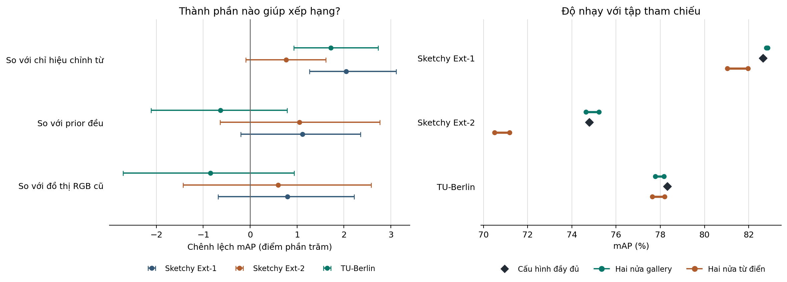

# Kết quả ZS-SBIR và mức phụ thuộc vào gallery

Cấu hình có trung bình mAP cao nhất trên hai split Sketchy dùng cả prior từ và lân cận ảnh. Nó đạt **82,65 / 74,79 / 78,32 mAP** trên Sketchy Ext-1, Ext-2 và TU-Berlin. Phần biến đổi qua khái niệm chung đã đem lại phần lớn mức cải thiện của CLIP gốc. Việc ước lượng tần suất khái niệm từ gallery làm phương pháp nhạy với bộ ảnh tham chiếu. Đợt thực nghiệm tiếp theo đo trực tiếp khả năng giữ nguyên điểm cho cùng một cặp sketch–photo khi thay gallery. [Phương pháp chấm theo từng cặp](PAIRWISE_TRANSFER_RESULTS_VI.md)

## So sánh đầy đủ

Mỗi ô ghi **mAP / precision**, đơn vị %. Ext-1 và TU dùng mAP@all / P@100, Ext-2 dùng mAP@200 / P@200. Hai split unseen của Sketchy dùng để chọn một cấu hình theo trung bình mAP với trọng số ngang nhau. Precision là tiêu chí khi hòa. Điểm TU dùng đúng cấu hình đã khóa trên Sketchy.

| Cách chấm | Sketchy Ext-1 | Sketchy Ext-2 | TU-Berlin 30 lớp |
|---|---:|---:|---:|
| Cosine ảnh–ảnh của cùng CLIP ViT-B/32 | 30,29 / 41,64 | 36,34 / 33,85 | 29,07 / 46,26 |
| Chứng cứ từ chung, prior đều | 75,31 / 78,94 | 71,42 / 70,28 | 73,35 / 77,22 |
| Chứng cứ từ chung, prior gallery | 80,60 / 81,27 | 74,02 / 72,86 | 76,59 / 77,08 |
| WinCLIP, cửa sổ trên từng photo | 75,50 / 78,97 | 71,42 / 70,28 | 73,75 / 77,44 |
| FreeDom, proxy RGB theo cấu hình bài gốc | 45,18 / 44,05 | 40,36 / 39,74 | 53,83 / 55,94 |
| FreeDom, vòng đầu qua từ, 96 thành viên | 77,99 / 80,77 | 72,30 / 71,00 | 73,91 / 78,27 |
| Relevance model, xác suất từ của proxy | 81,56 / 81,57 | 74,63 / 73,56 | 75,98 / 76,12 |
| Prior đều, diffusion trên đồ thị RGB | 81,86 / 81,33 | 74,20 / 72,68 | **79,16** / **80,24** |
| Prior gallery, trung bình lân cận RGB | **82,65** / **82,10** | **74,79** / **73,59** | 78,32 / 77,60 |

Các giá trị, commit, metric cutoff và SHA-256 theo cấu hình nằm trong bảng máy đọc được. Các lỗi hạng và so sánh ghép cặp theo lớp có trong hồ sơ đi kèm. [Mọi đối chứng và cả hai metric](results/map-followup/metrics.csv) · [Khóa chọn phương pháp](results/map-followup/joint-freeze.json) · [Relevance model](results/map-followup/relevance-result.json)

## Lỗi của CLIP gốc và kết quả khi can thiệp

Trên mẫu chẩn đoán, cosine toàn ảnh xếp khoảng 61–65% ảnh cùng lớp sau hạng 1.000. Đổi sang chấm mức đồng thuận trên 20.931 từ Open Images cho 75,31 / 71,42 / 73,35 mAP, ngay cả khi mọi từ có cùng prior và điểm của một cặp độc lập với mọi ảnh còn lại. Xáo danh tính từ giữa hai miền trong thí nghiệm khái niệm chung làm precision giảm xuống 4,39 / 3,62 / 6,77. Điều này ủng hộ vai trò của việc nối hai miền bằng **đúng nội dung của từng từ**. Cùng một encoder có đủ tín hiệu để phân biệt nhiều cặp mà cosine toàn ảnh xếp sai. [Chẩn đoán có đường dẫn ảnh sai và đúng](CLIP_RETRIEVAL_DIAGNOSIS.md) · [Ablation và nguyên nhân còn bỏ ngỏ](ZS_SBIR_GENERALIZATION_VI.md)

**FreeDom cho thấy lỗi vòng đầu có thể lan sang vòng sau.** Giữ 19 ảnh proxy, cùng một sketch và cùng phép bỏ phiếu cho từ. Tỷ lệ proxy đúng lớp chuyển từ 38,63% lên 77,99% ở Ext-1 và từ 33,15% lên 69,64% ở Ext-2 khi tìm ảnh qua khái niệm. Số truy vấn có cả 19 proxy sai giảm từ 509 xuống 167 trên 1.200 truy vấn và từ 368 xuống 141 trên 1.008 truy vấn. Khi giữ cách tìm proxy và thay phép bỏ phiếu cứng bằng phân bố mềm dùng mọi từ, mAP mẫu giảm từ 75,74 xuống 74,26 và từ 71,55 xuống 71,08. Trong hai can thiệp này, sửa thứ hạng vòng đầu cho hiệu ứng rõ hơn. [Kiểm tra độ đúng của proxy](results/map-followup/freedom-proxy-audit.json) · [Đối chứng cùng proxy và cùng phép ghép prompt](results/map-followup/freedom-vote-ablation.json) · [FreeDom, WACV 2025](https://arxiv.org/abs/2412.03297)

**Bằng chứng từ vùng ảnh có lợi nhỏ.** Trộn trọng số 0,25 cho posterior từ các cửa sổ 5×5 patch của WinCLIP với posterior toàn ảnh. Mức tăng mAP so với toàn khung là khoảng +0,19 / +0,01 / +0,40 điểm. Dùng các patch đã được attention qua toàn ảnh trên cùng vùng chỉ đạt 75,26 / 71,41 / 73,30. Đây là đối chứng giữa hai cách lấy tín hiệu cục bộ trên cùng backbone. [Thực nghiệm WinCLIP](https://github.com/HieuNM1804/training-free-ZS-SBIR/blob/research/winclip-concept-likelihood/docs/WINCLIP_RETRIEVAL_VI.md) · [WinCLIP, CVPR 2023](https://openaccess.thecvf.com/content/CVPR2023/html/Jeong_WinCLIP_Zero-Few-Shot_Anomaly_Classification_and_Segmentation_CVPR_2023_paper.html)

**Ảnh lân cận giúp khôi phục các ảnh đúng ở sâu trong danh sách.** Trong cấu hình cao nhất trên Sketchy, ước lượng prior từ gallery không nhãn bằng maximum likelihood, rồi lấy trung bình phân bố từ của 256 photo lân cận, loại chính ảnh đang lập chỉ mục. Cơ chế bổ sung bằng chứng cho một ảnh lấy từ nghiên cứu language model theo cụm tài liệu. Bỏ lân cận hạ mAP **2,05 / 0,77 / 1,72 điểm**. Trên TU, khoảng bootstrap theo lớp của mức tăng là **[0,93, 2,73]**, có 25/30 lớp tăng. Nếu giữ lân cận và đổi prior sang đồng đều, điểm trở thành **81,54 / 73,74 / 78,95**. Nguồn của cách chuyển qua từ, prior và lân cận lần lượt là FreeDom, nghiên cứu label shift và truy hồi ngôn ngữ theo cụm. Hệ số Gaussian 0,36 là quy ước bề rộng kế thừa thêm từ đối chứng diffusion của Wang và cộng sự. [Phương trình và mọi ablation](https://github.com/HieuNM1804/training-free-ZS-SBIR/blob/research/neighborhood-calibrated-likelihood/docs/NEIGHBORHOOD_CALIBRATED_LIKELIHOOD_VI.md) · [Liu và Croft, SIGIR 2004](https://ciir.cs.umass.edu/pubfiles/ir-347.pdf) · [Alexandari và cộng sự, ICML 2020](https://proceedings.mlr.press/v119/alexandari20a.html)

So với diffusion dùng prior đều, chênh lệch mAP của cấu hình này lần lượt là +0,80, +0,59 và −0,85 điểm. Khoảng bootstrap 95% theo lớp lần lượt là [−0,69, 2,22], [−1,43, 2,58] và [−2,71, 0,94]. Chênh lệch thay đổi theo lớp và theo bộ ảnh. Ví dụ ở Ext-2, AP của sketch trực thăng *n03512147_438-4* tăng từ 16,08 lên 87,85 dù top 1 vẫn là chim mòng biển. AP của sketch tê giác *n02391994_15347-3* giảm từ 100 xuống 28,46 khi ảnh bò đứng đầu. [Khoảng tin cậy và kết quả theo lớp](results/map-followup/comparison.json) · [Các truy vấn cụ thể](results/map-followup/example-queries.json)

## Gallery và từ điển quyết định phần nào của kết quả

| Nguồn thay đổi, giữ nguyên các hệ số | Ext-1 mAP | Ext-2 mAP | TU mAP |
|---|---:|---:|---:|
| Toàn bộ ảnh tham chiếu | 82,65 | 74,79 | 78,32 |
| Hai nửa gallery, mỗi lần xếp toàn bộ ảnh | 82,86 / 82,80 | 74,64 / 75,22 | 78,17 / 77,77 |
| Hai nửa từ điển công khai | 81,03 / 81,97 | 70,51 / 71,18 | 77,63 / 78,19 |

Mang nguyên vector prior từ 27.447 ảnh Sketchy sang TU chỉ đạt **51,64 mAP** với cùng cơ chế lân cận trên TU. Kết quả phân nửa gallery cho thấy cùng một thuật toán có thể lập chỉ mục từ tập con cùng phân bố. Phép chuyển prior cho thấy tham số thống kê thu được phụ thuộc đáng kể vào bộ ảnh đích. Ở 18 lớp Ext-2 có tên nguyên văn chỉ xuất hiện ở một nửa từ điển, 10.665 query đạt 73,71 mAP với nửa có tên và 65,71 với nửa còn lại. Hai nửa cũng khác ở hàng nghìn từ liên quan. Quan sát này đo một liên hệ với độ phủ từ. [Giao thức lập trước](MAP_PORTABILITY_PROTOCOL_VI.md) · [Đủ hai nửa và kết quả trên ảnh chưa dùng lập chỉ mục](results/map-followup/portability.json)

## Phạm vi đánh giá

Tất cả các hàng thực nghiệm dùng một OpenAI CLIP ViT-B/32 đóng băng trên Colab L4. Mỗi sketch được truy hồi độc lập. Bảng từ công khai đã được chấp thuận là tài nguyên ngoài. Query/gallery của Ext-1, Ext-2 và TU lần lượt có 14.179/17.100, 12.694/12.552 và 2.130/27.262 ảnh. Replay hàm KD-SBIR theo từng query khớp khi dùng cùng thứ hạng. Trong kiểm tra tính lại độc lập của phương pháp lân cận, 14 truy vấn TU đổi một ảnh đúng ở ngưỡng P@100 do điểm sát nhau. Sai lệch mAP toàn tập dưới 0,0008 điểm phần trăm. Bảng giữ kết quả chính thức đã khóa. [Bản ghi replay](results/map-followup/comparison.json) · [Sai số kiểm tra độc lập](results/map-followup/portability.json)

Với QuickDraw, phép chấm bổ sung trước đây chỉ áp dụng cấu hình diffusion với prior đều, cho **45,69 mAP@all, 46,31 P@200** trên 91.491 sketch, 56.407 ảnh và 30 lớp. Bằng chứng trực tiếp hiện có nằm trong nhiệm vụ sketch → photo. [Kết quả QuickDraw đã khóa](https://github.com/HieuNM1804/training-free-ZS-SBIR/blob/eea2579d650cfca1f92779b71495ed0d900c7336/docs/results/quickdraw-locked-map/quickdraw.json) · [Nghiên cứu làm cơ sở cho các phép thử](MAP_FOLLOWUP_RESEARCH_VI.md)
