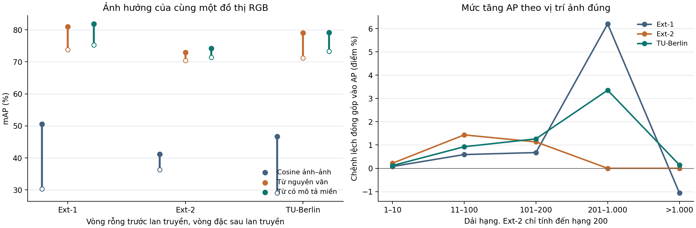

# Xếp hạng qua khái niệm và cấu trúc gallery

Kết quả của lượt chọn theo mAP ban đầu đạt **81,86 mAP@all trên Sketchy Ext-1, 74,20 mAP@200 trên Ext-2 và 79,16 mAP@all trên TU-Berlin**. Cấu hình dùng cùng OpenAI CLIP ViT-B/32 với baseline. Sketchy dùng để chọn cấu hình trên unseen và kết quả ở đó là thăm dò. Bản ghi chứa SHA-256 của điểm trên Sketchy, tham số, commit và thời điểm khóa trước khi chấm đủ 30 lớp TU-Berlin. [Bảng kết quả](results/map-study/full-metrics.csv) · [Khóa chung](results/map-study/joint-freeze.json)

| Đối chứng | Ext-1 mAP@all | Ext-2 mAP@200 | TU mAP@all |
|---|---:|---:|---:|
| Cosine ảnh–ảnh CLIP | 30,29 | 36,34 | 29,07 |
| Cosine ảnh–ảnh rồi lan truyền RGB | 50,52 | 41,21 | 46,68 |
| Điểm qua từ, prior đều | 75,31 | 71,42 | 73,35 |
| Điểm qua từ, prior MLE | 80,60 | 74,02 | 76,59 |
| Dự báo khái niệm từ lân cận RGB | 81,89 | 73,34 | 78,65 |
| Dịch khái niệm qua đồng xuất hiện trên ảnh | 80,82 | 73,28 | 78,54 |
| Điểm qua từ, prior đều, lan truyền RGB | **81,86** | **74,20** | **79,16** |

## Lỗi xếp hạng

CLIP khớp sketch với ảnh qua cosine có thể đặt ảnh có phong cách hoặc bố cục gần sketch lên trước ảnh cùng vật thể. Phân tích lỗi đã lưu các cặp ảnh sai đứng đầu và ảnh đúng tốt nhất của cosine. Điểm qua từ với prior MLE đảo đúng 7.604/8.979 cặp trên Ext-1, 6.770/8.008 trên Ext-2 và 683/881 trên TU. Trong phép thử trừ hướng miền, bỏ một hướng đặc trưng chỉ giải thích một phần mức tăng. Quan sát xác lập giới hạn trong cách dùng embedding toàn ảnh để chấm cặp với checkpoint này. Nguyên nhân chính xác trong pretraining chưa được can thiệp trực tiếp. [Chẩn đoán ban đầu](CLIP_RETRIEVAL_DIAGNOSIS.md) · [Các cặp lỗi cụ thể và từ đóng góp](results/shared-concept-likelihood/generalization-audit.json)

Một số sketch đã có ảnh đúng ở hạng đầu nhưng AP vẫn thấp. Trên Ext-1, khi dùng likelihood đã hiệu chỉnh prior, 1.077 truy vấn trong số các truy vấn đúng top 1 có AP dưới 0,75. Mẫu cố định của Ext-1 cho thấy tỷ lệ ảnh đúng ở hạng 201–1.000 tăng từ 54,21% lên 58,10% sau lan truyền so với likelihood prior đều. Tại Ext-2, đóng góp hạng 101–200 vào AP tăng từ 35,07 lên 36,20 điểm. Tăng top 1 và tăng chất lượng xếp hạng nhiều ảnh đúng là hai phép đo khác nhau. [Chẩn đoán vị trí](results/map-study/diagnosis.json) · [Kiểm tra ghép cặp](results/map-study/transfer-audit.json)

## Cơ chế đã chọn và phạm vi bằng chứng

CLIP đóng băng tính điểm quan sát trên toàn bộ 20.931 từ công khai. Hai bank dùng cùng từ với prompt miền khác nhau. Điểm ban đầu là kỳ vọng likelihood của từ theo posterior của ảnh gallery. Điểm cuối lấy kỳ vọng của điểm ban đầu theo kernel RGB đã lan truyền. Kernel địa phương dùng 16 láng giềng với Gaussian, hệ số bề rộng 0,36 và hai vòng. Từng sketch truy cập chỉ mục ảnh riêng. FreeDom cung cấp phép chuyển miền qua từ rời rạc, Bayesian Sets cung cấp ý tưởng xét chung khái niệm, và Wang và cộng sự cung cấp dạng cập nhật diffusion (H leftarrow K H K^	op). [FreeDom, WACV 2025](https://arxiv.org/abs/2412.03297) · [Bayesian Sets, NeurIPS 2005](https://proceedings.neurips.cc/paper/2005/hash/182e6c2d3d78eef40e5dac7da77a748f-Abstract.html) · [Wang và cộng sự, CVPR 2012](https://cs.nju.edu.cn/zhouzh/zhouzh.files/publication/cvpr12.pdf)

Trên TU, so prior đều, mAP tăng 5,81 điểm với khoảng bootstrap theo lớp 95% từ 4,52 đến 7,16 và 28/30 lớp tăng. So prior MLE, mức tăng là 2,57 điểm với khoảng từ 0,56 đến 4,58. Với 1.700 sketch thuộc 24 lớp TU có tên nằm ngoài hai split Sketchy, kết quả đạt 81,14 mAP@all, so 74,88 từ prior đều, cùng toàn gallery. Khi chia ngẫu nhiên mỗi gallery thành hai nửa và lập lại chỉ mục, kết quả trên mẫu tương ứng với từng nửa vẫn cao hơn prior đều ở cả sáu trường hợp. [Số theo lớp và nửa gallery](results/map-study/transfer-audit.json)

Ở cùng tham số, hai đồ thị cho 81,38 / 74,58 / 79,67 mAP. Bằng chứng Sketchy chọn cấu hình một đồ thị theo trung bình mAP. Khoảng bootstrap của chênh lệch hai biến thể bao gồm 0 ở Ext-2 và TU. Khả năng chuyển giao đã đo giữa các bộ dữ liệu sketch → ảnh. QuickDraw là phép thử bổ sung đã được yêu cầu riêng với cấu hình khóa sẵn và đạt 45,69 mAP@all, 46,31 P@200. [Kết quả QuickDraw](https://github.com/HieuNM1804/training-free-ZS-SBIR/blob/eea2579d650cfca1f92779b71495ed0d900c7336/docs/results/quickdraw-locked-map/quickdraw.json)

