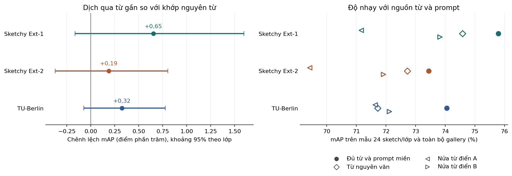

# Truy hồi xuyên miền bằng khớp và dịch khái niệm công khai

**Khi yêu cầu điểm của mỗi cặp sketch–photo độc lập với bộ ảnh còn lại, phương pháp được chọn trên hai split Sketchy là dịch qua các từ gần nghĩa trong CLIP.** Phương pháp đạt **75,96 mAP@all trên Sketchy Ext-1, 71,60 mAP@200 trên Ext-2 và 73,68 mAP@all trên TU-Berlin đủ 30 lớp**. Khớp qua ngôn ngữ đóng góp phần lớn mức tăng so với cosine ảnh–ảnh. Thêm phép dịch từ cho lợi ích nhỏ và còn bất định theo lớp. Các kết quả dưới đây thuộc thiết lập dùng từ điển công khai.

| Mỗi ô là mAP / precision (%) | Sketchy Ext-1 | Sketchy Ext-2 | TU-Berlin |
|---|---:|---:|---:|
| CLIP ViT-B/32 gốc, cosine trên embedding ảnh | 30,29 / 41,64 | 36,34 / 33,85 | 29,07 / 46,26 |
| Khớp nguyên cùng một từ, prior đều | 75,31 / 78,94 | 71,42 / 70,28 | 73,35 / 77,22 |
| Cửa sổ WinCLIP trên từng photo | 75,50 / 78,97 | 71,42 / 70,28 | 73,75 / 77,44 |
| Inverted softmax, hiệu chỉnh độ phổ biến của từ | 71,57 / 75,10 | 65,58 / 64,71 | 70,66 / 75,31 |
| **Khớp và dịch qua bảy từ gần, chọn trên Sketchy** | 75,96 / 78,87 | 71,60 / 70,66 | 73,68 / 77,00 |

Precision là P@100 cho Ext-1 và TU, P@200 cho Ext-2. Hai split Sketchy unseen dùng để chọn cấu hình thăm dò theo trung bình mAP với trọng số bằng nhau. Lúc khóa bốn ứng viên, cả hai phương pháp từ điển mới đều chưa chấm TU. Các điểm TU lịch sử của hai đối chứng đã có sẵn. Cùng một checkpoint OpenAI ViT-B/32, ảnh đầu vào 224×224, 20.931 từ Open Images và một bộ prompt miền cố định được dùng xuyên suốt. Mọi phép tính thực nghiệm chạy trên GPU Colab L4. Nhãn chỉ phục vụ lấy mẫu chẩn đoán, đánh giá và chọn cấu hình Sketchy sau khi chấm. [Khóa chung trước TU](results/pairwise-transfer/strict-joint.json) · [Toàn bộ metric và kiểm tra từng truy vấn](results/pairwise-transfer/report.json)

## Hạn chế của CLIP gốc đã kiểm tra được

Một sketch và một photo đúng lớp có thể ở xa nhau theo cosine toàn ảnh, trong khi cả hai vẫn kích hoạt những khái niệm tương thích trong chính CLIP. Với mỗi truy vấn bị cosine xếp sai hạng nhất, lấy ảnh sai đứng đầu và ảnh đúng được chính cosine xếp cao nhất. Trên mẫu cố định 24 sketch mỗi lớp, cách chấm bằng khái niệm có dịch đảo đúng **325/403**, **242/317** và **208/283** cặp lần lượt ở Ext-1, Ext-2 và TU. Số query sai top 1 được sửa là **243, 167, 146**. Chiều ngược lại có **8, 17, 43** query mất kết quả đúng ở top 1. Các cặp đảo đúng và số query sửa top 1 khác nhau vì có thể còn một ảnh sai khác phía trước.

Trên toàn bộ dữ liệu, so với cosine ảnh–ảnh, phương pháp tăng **45,67 / 35,26 / 44,61 điểm mAP**. Mức tăng xuất hiện ở **25/25, 20/21 và 29/30 lớp**. Đối chứng xáo danh tính khái niệm giữa hai miền trong nghiên cứu trước đã triệt tiêu gần như toàn bộ lợi ích. Cùng một encoder biểu diễn được thông tin mà phép so cosine trực tiếp bỏ sót khi hai miền khác nhau. Các phép đo này xác định hạn chế của cách dùng embedding đã học để xếp hạng. Nguồn gốc của hạn chế trong quá trình tiền huấn luyện vẫn là câu hỏi mở. [Chẩn đoán từ baseline và đối chứng](CLIP_RETRIEVAL_DIAGNOSIS.md) · [Thí nghiệm xáo kết nối hai miền](ZS_SBIR_GENERALIZATION_VI.md)

## Công thức dùng lại được khi gallery thay đổi

Gọi \(L(q,u)=\exp[\tau\,q^\top t_{\mathrm{sketch},u}]\) là mức sketch phù hợp với từ \(u\). Cho photo \(g\), tính \(P(v\mid g)=\mathrm{softmax}_v[\tau\,g^\top t_{\mathrm{photo},v}]\). Hai miền có chung chỉ số từ. \(\tau\) lấy từ checkpoint. Dùng CLIP để mã hóa từng **từ nguyên văn** và tìm bảy từ gần nó nhất, bỏ chính nó. Với các embedding text đơn vị, \(d(u,v)\) là khoảng cách Euclid và \(\sigma_v\) là khoảng cách từ \(v\) đến từ gần thứ bảy. Chuẩn hóa theo hàng để tạo một kênh dịch giữa các từ của từ điển.

$$
T(u\mid v)\ \propto\ \mathbf 1[u\in N_7(v)]\exp\!\left[-\frac{d(u,v)^2}{\sigma_u\sigma_v}\right].
$$

Điểm cho một cặp đặt một nửa khối xác suất lên đúng từ và một nửa cho phép dịch một bước.

$$
S(q,g)=\sum_v P(v\mid g)\left[(1-\alpha)L(q,v)+\alpha\sum_u T(u\mid v)L(q,u)\right],\qquad \alpha=0{,}5.
$$

Kênh dịch được tạo một lần từ văn bản. Thêm hoặc xóa một photo khỏi chỉ mục chỉ làm thay đổi tập ứng viên. Các hệ số của phương pháp và điểm toán học của các cặp cũ giữ nguyên. Với hai split Sketchy, việc giới hạn phạm vi dịch và giá trị \(\alpha\) là lựa chọn thực nghiệm. Bảy láng giềng để tính bán kính lấy theo bài nghiên cứu phân cụm. Phạm vi này có thể mang sang một cặp miền mới có mô tả bằng text. Hiệu quả thực tế ở những miền ấy cần thí nghiệm riêng.

| Công trình trực tiếp | Phát hiện hoặc đối chứng của tác giả | Thành phần chuyển sang SBIR |
|---|---|---|
| FreeDom, WACV 2025 | Ảnh mang nội dung của truy vấn có thể được tìm trong một miền đích bằng việc đi qua từ vựng công khai. Bài kiểm tra các thành phần của bước chọn từ và ảnh bổ trợ. | Cho cả hai ảnh bằng chứng mềm trên cùng một từ điển qua prompt miền. [Paper](https://arxiv.org/abs/2412.03297) |
| Berger và Lafferty, SIGIR 1999 | Trong truy hồi văn bản, tài liệu có thể liên quan dù truy vấn dùng cách gọi khác. Tác giả đánh giá xác suất sinh truy vấn từ tài liệu qua phép dịch. | Xem photo như phân bố từ mềm, cho phép từ của photo tạo một từ khác mà sketch kích hoạt. [Paper](https://www.cse.iitb.ac.in/~soumen/readings/papers/BergerL1999xlate.pdf) |
| Zelnik-Manor và Perona, NeurIPS 2004 | Một bề rộng chung gặp khó khi mật độ các cụm khác nhau. Tác giả so với bề rộng theo từng điểm trên dữ liệu tổng hợp và ảnh, dùng láng giềng thứ bảy. | Xác định bề rộng từ hình học của từ điển và đo riêng tác dụng của nó trên cùng tập từ gần. [Paper](https://proceedings.neurips.cc/paper_files/paper/2004/file/40173ea48d9567f1f393b20c855bb40b-Paper.pdf) |

## Phép dịch sửa lỗi nào, và ở đâu nó thất bại

Trên Ext-1, cùng sketch đàn hạc *n03495258_8516-1*, khớp nguyên từ xếp ảnh chuông trước ảnh đàn hạc với điểm **0,1167 so với 0,1136**. Cả hai cặp đều có đóng góp nguyên từ lớn nhất là *triangle (musical instrument)*. Khi cho phép dịch, cặp *eigenharp → harp* đóng góp 22% bằng chứng dịch cho ảnh đúng. Ảnh đàn hạc lên hạng nhất với **0,0723 so với 0,0699** của ảnh chuông. Ở Ext-2, *sliding glass door → screen door* giúp ảnh cửa ra vào vượt ảnh cửa sổ. Trên TU có trường hợp ngược lại. Sketch khinh khí cầu *8592* mất ảnh đúng ở hạng nhất khi cặp *incandescent light bulb → light bulb* làm ảnh đèn sàn được ưu tiên. Điểm tuyệt đối được so trong cùng một cách chấm.

| Thay duy nhất một thành phần, mAP (%) | Ext-1 | Ext-2 | TU |
|---|---:|---:|---:|
| Giữ nửa trọng số cho khớp nguyên từ, dịch qua bảy từ | 75,96 | 71,60 | 73,68 |
| Chỉ giữ khớp nguyên từ | 75,31 | 71,42 | 73,35 |
| Cho phép dịch tới mọi từ khác | 75,31 | 71,42 | 73,36 |
| Chỉ dùng bằng chứng qua từ khác | 74,37 | 69,83 | 72,51 |
| Xáo danh tính từ cho phần dịch | 72,07 | 69,61 | 70,32 |
| Cùng bảy từ đích, dùng nhiệt độ CLIP cho trọng số | 76,22 | 71,38 | 73,85 |

Các đối chứng ủng hộ việc giữ cả bằng chứng nguyên từ và quan hệ có nghĩa trong một lân cận từ hẹp. Trên mẫu, chênh lệch mAP giữa trọng số cục bộ và cho bảy từ trọng số đều chỉ **+0,10 / +0,00 / +0,04 điểm**. Với toàn bộ truy vấn, khoảng tin cậy bootstrap 95% theo lớp của phần tăng so với nguyên từ là **[−0,16, 1,60]**, **[−0,37, 0,80]** và **[−0,07, 0,78]**. Lợi thế mAP có cùng chiều ở cả ba split, với 17/25, 12/21 và 17/30 lớp tăng. Các kết quả hiện tại chưa xác nhận một lợi thế ổn định của công thức bandwidth, hoặc đủ để xem riêng bước dịch là một đóng góp thuật toán mạnh. [Từng truy vấn, đối chứng, khoảng tin cậy và ví dụ](results/pairwise-transfer/report.json)

Giả thuyết khác là một số từ được CLIP ghép với quá nhiều prompt không liên quan. Chúng tôi dùng inverted softmax của Smith và cộng sự trong truy hồi từ song ngữ để tính hệ số hiệu chỉnh cho mỗi từ, chỉ dùng hai bank text. Dùng nửa nhiệt độ checkpoint cho điểm tốt nhất của họ phương pháp này trên Sketchy nhưng vẫn thấp hơn khớp nguyên từ trên cả ba split. Với toàn bộ nhiệt độ checkpoint, mAP chỉ còn 18,41 / 20,60 / 15,70. Kết quả bác bỏ lợi ích của cách chuyển hệ số hiệu chỉnh cụ thể này. [Smith và cộng sự, ICLR 2017](https://arxiv.org/abs/1702.03859) · [Công thức và bản chạy của đối chứng](https://github.com/HieuNM1804/training-free-ZS-SBIR/blob/research/public-word-calibration/docs/PUBLIC_WORD_CALIBRATION_VI.md)

## Phép kiểm tra khả năng chuyển giao

- **Thay gallery, đổi thứ tự và batch.** Trên mỗi split, lấy hai query và tám photo mỗi lớp, đảo thứ tự, bỏ mọi ảnh còn lại, rồi tính lại các cặp đó. Sai khác điểm tuyệt đối lớn nhất trên ba split là \(5{,}07\times10^{-7}\). Khi chạy thêm năm cặp đơn lẻ trên mỗi split, sai khác lớn nhất là \(4{,}89\times10^{-6}\). So điểm của đúng cặp tránh nhầm với thứ hạng thay đổi do xuất hiện đối thủ mới.
- **Lớp TU có tên khác Sketchy.** Với 1.700 query thuộc 24 lớp TU có tên nguyên văn khác các lớp từng dùng chọn cấu hình, xếp đủ 27.262 ảnh. Dịch qua từ đạt **75,31 mAP**, khớp nguyên từ đạt **74,88**, WinCLIP đạt **75,28**, cosine ảnh–ảnh đạt **31,25**. Các tên khác nhau vẫn có thể gần nghĩa hoặc xuất hiện trong dữ liệu tiền huấn luyện.
- **Thay từ điển và prompt.** Mẫu cố định 600 / 504 / 720 query dùng đủ gallery, lần lượt ở Ext-1, Ext-2 và TU. Dùng đầy đủ từ và prompt miền đạt 75,80 / 73,44 / 74,05 mAP. Dùng từ nguyên văn cho cả hai ảnh đạt 74,58 / 72,72 / 71,72. Chia đôi ngẫu nhiên từ điển đưa TU xuống 71,63 hoặc 72,11. Ở 432 query thuộc 18 lớp Ext-2 có tên chỉ xuất hiện trong một nửa, nửa có tên cho 71,94 mAP và nửa còn lại cho 66,10. Việc thay hàng nghìn từ cùng lúc còn ảnh hưởng các từ liên quan. Từ điển công khai và kiến thức về tên miền là hai nguồn thông tin cần khai báo.

## Đánh giá tính mới và khả năng tái lập

Phần có bằng chứng cơ chế rõ nhất là một lỗi có thể sửa bằng thông tin đã có trong CLIP. Lấy cùng hai ảnh, chỉ thay phép đo từ cosine toàn ảnh sang mức đồng thuận ngữ nghĩa thì nhiều cặp sai được đảo đúng. Phần đề xuất riêng ở đây là dùng **một kênh dịch có thể kiểm tra cho từng cặp từ**, xây hoàn toàn từ text, để giải thích trường hợp hai miền gọi cùng vật thể bằng hai cách khác nhau. Những thành phần gốc đã có tiền lệ ở các task khác. Chưa có đủ bằng chứng để tuyên bố ưu tiên lịch sử hoặc khẳng định phần tăng nhỏ này đủ cho một bài độc lập. Các bộ dữ liệu đã đo kiểm tra chuyển bộ dữ liệu bên trong bài toán sketch → photo. Việc chuyển sang hai miền thị giác khác vẫn là giả thuyết.

Nếu cho phép chỉ mục thích nghi theo gallery, các cấu hình điểm cao hơn lần lượt đạt **81,86 / 74,20 / 79,16** với prior đều và diffusion RGB, hoặc **82,65 / 74,79 / 78,32** với prior ước lượng và trung bình lân cận. Mang nguyên prior Sketchy sang TU cho **51,64 mAP** trong cấu hình thứ hai. Các thí nghiệm này giúp định lượng phần điểm đến từ cấu trúc của bộ ảnh đích. [Báo cáo đầy đủ các phương pháp có dùng gallery](MAP_FOLLOWUP_RESULTS_VI.md)

Lượt chấm phương pháp dùng commit *b2bb1506d8af*. Commit *0daf97d* tái tính độc lập các điểm và truy vấn chẩn đoán. Các metric của phương pháp chấm lại bằng hàm gốc KD-SBIR trên cùng thứ hạng với sai khác 0 cho từng AP và P của **29.003 query**. File ZIP có 170 tệp gồm AP/P từng query, top 10, khóa và điểm cho từng cấu hình. Dấu kiểm SHA-256 có trong manifest. [Mã tại commit chấm điểm](https://github.com/HieuNM1804/training-free-ZS-SBIR/blob/b2bb1506d8afd2be318b60b510530229a8a5ebcb/tf_sbir/public_semantic_translation.py) · [Mã chẩn đoán](https://github.com/HieuNM1804/training-free-ZS-SBIR/blob/0daf97d/tf_sbir/strict_public_audit.py) · [Manifest](results/pairwise-transfer/raw-archive.json) · [Hàm metric gốc](results/shared-concept-likelihood/kd-source.json)
