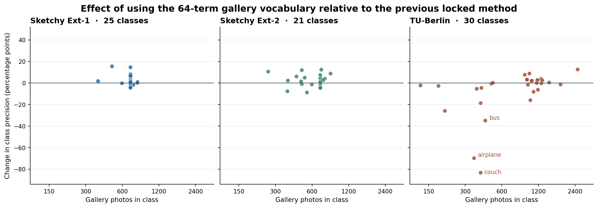

# Chọn từ đại diện cho gallery giúp Sketchy, nhưng mất gì khi sang TU-Berlin?

**Kết luận của đợt đối chứng.** Cả bốn hướng được lưu làm kết quả thực nghiệm âm đối với yêu cầu cải thiện nhất quán xuyên bộ dữ liệu. Chúng đã được loại khỏi các phương pháp đề xuất. Bảng dưới ghi lựa chọn thống kê của đợt thăm dò trên Sketchy để có thể kiểm tra nguyên nhân loại bỏ.

Một cấu hình mở rộng truy vấn trên **64 khái niệm được chọn riêng cho từng gallery** đạt **82,53% P@100 / 81,54% mAP@all** trên Sketchy Ext-1 và **73,88% P@200 / 74,98% mAP@200** trên Sketchy Ext-2. Cấu hình này thắng khi lấy trung bình precision hai split. Chuyển nguyên thuật toán và tham số sang TU-Berlin, kết quả là **73,01% P@100 / 70,08% mAP@all** trên đủ 30 lớp. Ảnh gallery TU tự quyết định 64 từ của nó. Không dùng tên lớp benchmark để lập danh mục.

## Cơ chế đã kiểm chứng

Phương pháp cũ cho mỗi ảnh chọn tám từ gần nhất trong danh mục 20.931 khái niệm Open Images. Khi một sketch bị nhầm, mười ảnh trả về đầu tiên thường đồng loạt thuộc một lớp sai, chẳng hạn kiếm đối với sketch hình cưa. Câu hỏi là liệu danh mục từ ở cấp gallery có giúp mỗi ảnh giữ những đặc điểm phân biệt các đối tượng trong chính gallery đó hay không.

Mỗi ảnh bỏ phiếu cho các từ CLIP thấy phù hợp. Trong 2.048 từ có nhiều phiếu nhất, chọn dần từ làm tăng nhiều nhất **tổng độ phù hợp của mỗi ảnh tham chiếu với từ tốt nhất của nó**. Bởi vậy có thể chọn một từ hỗ trợ nhóm ảnh trước đó chưa được mô tả tốt, ngay cả khi từ đó nhận ít phiếu hơn một từ gần trùng với lựa chọn cũ. Bước này dùng 1.536 ảnh gallery không nhãn. Tiếp đến, từng ảnh được biểu diễn bằng tổng có trọng số của 64 prompt sketch đã chọn, với trọng số lấy từ độ phù hợp của ảnh với các prompt photo tương ứng. Sketch toàn khung chấm các biểu diễn này. Dùng 256 ảnh dẫn đầu để tạo một vector phản hồi RGB. Điểm cuối gồm 35% điểm lượt đầu và 65% điểm phản hồi. Cấu hình thắng dùng một view và tắt đồ thị ảnh. [Mã truy hồi, đúng phiên bản chấm điểm](https://github.com/HieuNM1804/training-free-ZS-SBIR/blob/40211aa/tf_sbir/gallery_vocabulary_cover.py)

Ba cơ chế kế thừa gồm đảo qua từ vựng để chuyển miền, chọn tập con theo độ bao phủ và dùng láng giềng để phản hồi truy vấn. Đóng góp cần đánh giá là đổi đơn vị chọn từ sang toàn gallery và đo điều kiện mà sự rút gọn đó giúp hoặc gây hại. FreeDom đã dùng CLIP để chuyển miền trong retrieval. Các công trình phân lớp mở và segmentation cũng đã nghiên cứu lọc danh mục ứng viên. [FreeDom, WACV 2025](https://arxiv.org/abs/2412.03297) · [Wei và cộng sự, ICML 2015](https://proceedings.mlr.press/v37/wei15.html) · [Arandjelović và Zisserman, CVPR 2012](https://www.robots.ox.ac.uk/~vgg/publications/2012/Arandjelovic12/arandjelovic12.pdf) · [Phân tích các công trình liên quan và những giả thuyết đã loại](RESIDUAL_STUDY_LITERATURE_VI.md)

## Những đối chứng giải thích thay đổi thứ hạng

Các phương pháp được so trên cùng gallery, một checkpoint và cùng thứ tự truy vấn. Mỗi ô trong bảng sau ghi precision / mAP (%). Ext-1 và TU dùng P@100 / mAP@all. Ext-2 dùng P@200 / mAP@200.

| Phương pháp đã khóa | Sketchy Ext-1 | Sketchy Ext-2 | TU-Berlin |
|---|---:|---:|---:|
| CLIP gốc, cosine toàn ảnh | 41,64 / 30,29 | 33,85 / 36,34 | 46,26 / 29,07 |
| Chuyển ảnh gallery sang prompt sketch, phương pháp cũ | 80,14 / 80,85 | 71,59 / 73,16 | **80,61 / 76,96** |
| Phản chiếu sketch, gộp view theo entropy | 81,53 / 79,21 | 72,23 / 73,61 | 79,99 / 74,98 |
| Truy hồi qua cụm ảnh đặt tên bằng CLIP | 81,24 / 80,08 | 72,62 / 74,35 | 79,62 / 76,15 |
| Vùng từ khóa patch CLIP và ảnh toàn khung | 81,87 / 79,40 | 72,37 / 73,83 | 78,69 / 73,48 |
| **64 từ đại diện cho gallery** | **82,53 / 81,54** | **73,88 / 74,98** | 73,01 / 70,08 |

Không có nhánh mới nào vượt phương pháp cũ về precision trên cả ba split. Chọn cấu hình theo hai split Sketchy giúp cải thiện ở cả hai, đồng thời làm lộ đánh đổi trên bộ kiểm tra chuyển giao. [Quyết định khóa trước lượt TU](results/residual-study/final-selection.json)

Đối với nhánh 64 từ, chênh lệch precision so với mốc cũ là +2,39 / +2,29 / −7,60 điểm. Khoảng bootstrap 95% theo lớp lần lượt là [0,68 đến 4,32], [−0,28 đến 4,85] và [−15,79 đến −1,06] điểm. Hai khoảng trên Sketchy được tính sau chọn cấu hình. Với cùng thứ hạng, AP và precision của từng truy vấn khớp hàm gốc trong KD-SBIR trên cả 29.003 sketch. [Kiểm chứng toàn bộ và thay đổi theo lớp](results/residual-study/audit.json) · [Bảng mọi cấu hình](results/residual-study/all-configurations.csv)

| Trong cùng nhánh, giữ nguyên phần còn lại | Ext-1 P@100 | Ext-2 P@200 | TU P@100 |
|---|---:|---:|---:|
| **64 từ theo độ bao phủ** | **82,53** | **73,88** | **73,01** |
| 64 từ có nhiều phiếu nhất trong cùng 2.048 ứng viên | 74,29 | 66,72 | 62,82 |
| 64 từ ngẫu nhiên trong danh mục công khai | 30,25 | 21,95 | 40,03 |
| Mỗi ảnh dùng tám từ tốt nhất trong toàn danh mục | 80,71 | 71,67 | 79,64 |
| 64 từ theo độ bao phủ, bỏ phản hồi từ ảnh | 80,78 | 72,87 | 73,21 |
| Giữ từ, dùng prompt photo ở cả hai phía | 81,26 | 70,84 | 72,53 |
| Xáo danh tính từ khi đổi prompt photo sang sketch | 3,94 | 1,31 | 2,24 |
| Chỉ dùng cosine RGB và cùng phản hồi | 44,95 | 38,21 | 52,38 |

Chọn theo độ bao phủ đạt precision cao hơn chọn theo tần suất trên cả ba split ở cùng ngân sách 64 từ. Trong khi đó, thay mã từ không hạn chế của từng ảnh bằng danh mục chung cải thiện **1,82 và 2,20 điểm** trên Sketchy, nhưng giảm **6,63 điểm** trên TU. Bỏ phản hồi chỉ đưa TU lên 73,21%. Kết quả vì vậy tập trung vấn đề chuyển giao ở bước nén danh mục gallery. [Mã chấm](../tf_sbir/residual_benchmark.py)

TU có 128–2.520 ảnh/lớp, trong khi Ext-1 có 378–800 và Ext-2 có 261–850. So với cấu hình mạnh trước đây, lớp `couch` giảm khoảng 83 điểm precision, `airplane` giảm khoảng 70 và `bus` khoảng 35. Tương quan hạng Spearman giữa số ảnh của lớp TU và chênh lệch precision là **0,535**. Đây là quan sát hậu nghiệm trên 30 lớp. Thử nghiệm hiện tại chưa tách tác động nhân quả của kích thước lớp khỏi độ khó của hình dạng hoặc chất lượng tên trong danh mục. [Chênh lệch theo lớp và phân bố gallery](results/residual-study/gallery-composition.json)

Khi đo trên những ảnh nằm ngoài 1.536 ảnh tham chiếu, điểm bao phủ trung bình của 64 từ chọn tham lam là 0,825 / 0,854 / 0,764, cao hơn 0,746 / 0,756 / 0,691 của phương án chọn theo tần suất. Chỉ 14/25, 11/21 và 8/30 tên lớp trùng nguyên văn với danh mục 64 từ. Trùng tên ít hơn vẫn có thể tạo ra precision tốt hơn phương án chọn theo tần suất. Trên TU, độ bao phủ của `couch` chỉ là 0,365 và của `airplane` là 0,437. Precision của hai lớp lần lượt đổi từ 85,86% xuống 2,64% và từ 88,26% xuống 18,63%. [Danh mục từ thật và điểm bao phủ theo lớp](results/residual-study/lexicon-audit.json)

Thay seed 711 bằng 1321 và 3821 đúng kế hoạch đã ghi trước khi mở TU. P trên ba seed nằm trong khoảng **81,53–82,96%** ở Ext-1, **71,43–73,88%** ở Ext-2 và **73,01–75,25%** ở TU. Điểm báo cáo chính giữ seed 711. Sự suy giảm trên TU vẫn xuất hiện ở cả ba lần lấy mẫu. [Kế hoạch về seed](results/residual-study/lexicon-stability-plan.json)

## Khoảng cách với kết quả công bố

SeCo-SBIR huấn luyện các thành phần thích nghi trên ViT-B/32, công bố P là 87,0 / 77,5 / 84,7 và mAP là 80,6 / 80,0 / 78,7 theo thứ tự Ext-1 / Ext-2 / TU. Khoảng cách precision của phương pháp 64 từ là **4,47 / 3,62 / 11,69 điểm**. mAP Ext-1 cao hơn mốc công bố 0,94 điểm, trong thiết lập có chọn tham số trên unseen Sketchy. Một đối chiếu khác về quy mô backbone là MLFA + PCMI tại ECCV 2026, dùng ViT-L/14 có huấn luyện, báo P là 89,6 / 82,0 / 81,3. Các số từ paper là mốc tham khảo giữa các nghiên cứu. [SeCo-SBIR, Bảng 1](https://arxiv.org/html/2608.03120v1#S4.T1) · [MLFA + PCMI, Bảng 1](https://media.eventhosts.cc/Conferences/ECCV2026/pdfs/9322.pdf)
