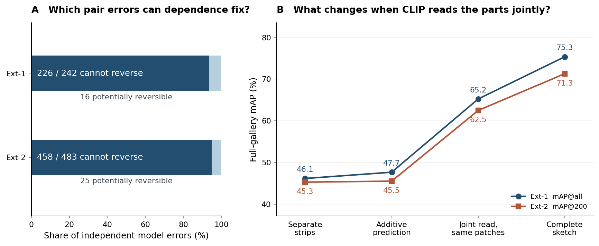

# Cùng các patch, CLIP đọc chung hay đọc riêng có ảnh hưởng gì đến truy hồi?

Trong mỗi sketch, lấy hai dải patch tách biệt ở hai phía và giữ nguyên tọa độ gốc. Lần lượt đọc chúng riêng rẽ, cộng các đặc trưng CLIP của hai phần sau khi trừ nền CLS, hoặc đưa cùng các patch đó vào một lần đọc CLIP. Cấu hình cuối cùng mới bổ sung hàng hoặc cột ở giữa. Thực hiện theo cả trục ngang và dọc. Đánh giá 2.180 / 1.828 sketch từ ảnh nguồn không thuộc nghiên cứu khám phá, với toàn bộ 17.100 / 12.552 ảnh gallery. Mọi hàng dùng cùng evaluator KD-SBIR, frozen OpenAI CLIP ViT-B/32 và seed 42. Bảng dùng toàn bộ 20.931 từ với một góc nhìn sketch. Đây là kết quả của riêng nhánh ngữ nghĩa trực tiếp trên tập truy vấn này.

| Cách đọc | Ext-1 mAP@all / P@100 | Ext-2 mAP@200 / P@200 |
|---|---:|---:|
| Đọc riêng hai dải, kết hợp xác suất trùng từ | 46,15 / 49,38 | 45,27 / 43,96 |
| Dự báo nghĩa chung bằng đặc trưng cộng tính của hai lần đọc | 47,65 / 50,63 | 45,51 / 44,18 |
| CLIP đọc chung đúng các patch đó | **65,22 / 69,02** | **62,47 / 61,06** |
| Đưa lại cả dải giữa, đọc toàn sketch | 75,35 / 79,17 | 71,29 / 70,07 |

Giữ nguyên pixel và vị trí, đọc chung thay cho dự báo cộng tính tăng **17,57 / 16,96 điểm mAP**. Khoảng bootstrap 95% khi cho trọng số bằng nhau theo lớp là [13,96, 21,02] / [11,15, 23,70] điểm. AP trung bình tăng ở 24/25 lớp Ext-1 và 20/21 lớp Ext-2. Việc cung cấp thêm dải giữa đưa mAP lên tiếp 10,12 / 8,82 điểm. Khi chia đôi từ vựng ở cả hai phương án, hiệu ứng đọc chung vẫn là +16,21 / +15,93 mAP. Các hiệu ứng được phân rã theo đúng thứ tự can thiệp. Đổi thứ tự can thiệp có thể cho phân rã khác.

Trên các cặp sát hạng đã chọn, độ chính xác cân bằng của phép đọc chung và cộng tính lần lượt là 60,77% / 61,28% ở Ext-1 và 50,41% / 49,72% ở Ext-2. Lợi ích lớn trên toàn gallery vì thế không bảo đảm cải thiện trên mọi tập con khó. Phép đọc lại cả 49 patch cho đúng embedding chuẩn trong batch kiểm tra, và lũy thừa bậc hai của điểm trực tiếp tái lập hai metric từng truy vấn trong dung sai evaluator. Việc dùng lại cache gallery nguyên gốc thay cache từ lần đọc tập vùng trước đây không đổi thứ tự của cặp tham chiếu nào trên cả hai split. Ý nghĩa của phép thử là nhiều thông tin truy hồi nằm trong **cách CLIP mã hóa các phần khi cùng nhìn thấy chúng**. Để tuyên bố một thuật toán mới, cần tiếp tục chứng minh một ảnh ứng viên cụ thể giúp khai thác lượng thông tin đó.

[Đồ thị PDF](semantic-context-and-limits.pdf) · [Protocol và phép phân rã](protocol.md) · [Ext-1](sketchy_1.json) · [Ext-2](sketchy_2.json) · [Kết quả ghép cặp từng truy vấn](paired-T4.zip)
